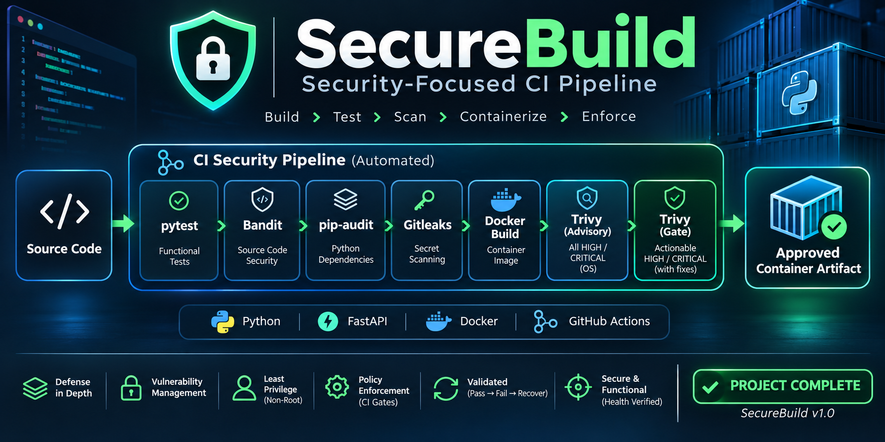

# SecureBuild

<p align="center">
  
</p>

## Project Overview

SecureBuild is a hands-on security engineering project that demonstrates how a small Python/FastAPI application can be built, tested, containerized, analyzed, and protected through an automated CI pipeline.

The project was developed incrementally across seven sprints. Each sprint added a new engineering or security layer, with the final objective of enforcing a simple rule:

> **No artifact should be considered approved unless the required functional and security checks pass.**

SecureBuild is designed as an early-career security engineering portfolio project focused on practical implementation, control validation, troubleshooting, and defense in depth.

---

## Project Status

**SecureBuild v1.0 — Complete**

### Completed Sprints

* Sprint 1 — API Foundation
* Sprint 2 — Automated Testing
* Sprint 3 — Containerization and Hardening
* Sprint 4 — CI Foundation
* Sprint 5 — Source, Dependency, and Secret Scanning
* Sprint 6 — Security Gates and Policy Enforcement
* Sprint 7 — Container Security

---

## Application

SecureBuild uses a small FastAPI application with three primary endpoints:

* `GET /` — application message
* `GET /health` — health status
* `GET /info` — application name and version

Automated tests validate expected API behavior and confirm that undefined routes return the expected HTTP response.

---

## CI Security Pipeline

SecureBuild uses GitHub Actions to automatically evaluate changes pushed to the repository or submitted through pull requests.

The final pipeline follows this flow:

```text
Source Code
    ↓
Automated Tests
    ↓
Bandit Source Security Gate
    ↓
pip-audit Dependency Gate
    ↓
Gitleaks Secret Scan
    ↓
Docker Image Build
    ↓
Trivy Advisory Vulnerability Scan
    ↓
Trivy Blocking Container Security Gate
    ↓
Approved / Rejected Pipeline Result
```

Each control evaluates a different risk domain so that no single scanner is treated as a complete security solution.

---

## Security Controls

### Automated Testing — pytest

pytest verifies expected application behavior before security analysis continues.

Any functional test failure blocks the pipeline.

---

### Static Application Security Testing — Bandit

Bandit analyzes the Python application for insecure coding patterns.

SecureBuild uses a risk-based threshold:

* LOW / MEDIUM findings — advisory and subject to review
* HIGH findings — blocking

The Bandit gate was validated using a controlled HIGH-severity `shell=True` finding.

Validation included:

1. Clean baseline — PASS
2. Controlled HIGH-severity violation — FAIL
3. Remediation — PASS

---

### Dependency Vulnerability Scanning — pip-audit

pip-audit evaluates the Python runtime dependencies listed in `requirements.txt` for known vulnerabilities.

Known dependency vulnerabilities are treated as blocking findings in the current v1 policy.

A deliberately vulnerable dependency was used during development to verify that the scanner could identify known package vulnerabilities.

---

### Secret Scanning — Gitleaks

Gitleaks scans repository history for potential exposed credentials or secrets.

The GitHub Actions checkout uses full repository history so Gitleaks can evaluate historical commits rather than only the latest snapshot.

Controlled fake-secret testing was used to verify detection behavior without exposing real credentials.

---

## Container Security

SecureBuild packages the FastAPI application inside a Docker container.

The container uses:

```dockerfile
FROM python:3.14-slim
```

The runtime image installs only application dependencies and runs the application under a dedicated non-root account:

```text
securebuild
```

Runtime validation confirmed the application executes with a non-root UID/GID while continuing to return a successful health response.

---

## Trivy Image Vulnerability Scanning

Trivy evaluates operating-system packages inside the final container image.

SecureBuild separates **visibility** from **enforcement**.

### Advisory Scan

The advisory scan reports all HIGH and CRITICAL OS-package vulnerabilities.

Its purpose is visibility and risk awareness.

Findings do not automatically block CI.

### Blocking Gate

The blocking Trivy gate evaluates:

* OS packages only
* HIGH and CRITICAL severity
* vulnerabilities with an available fix

A qualifying vulnerability causes Trivy to return a nonzero exit code and blocks the pipeline.

This avoids permanently failing builds on inherited upstream vulnerabilities that currently have no available remediation while still keeping those findings visible.

---

## Container Security Validation

The Trivy control was tested through a complete validation cycle:

```text
Intended Policy
→ PASS

Controlled Policy Regression
→ FAIL

Policy Restoration
→ PASS
```

The controlled regression temporarily included currently unfixed HIGH vulnerabilities in the blocking policy, causing the workflow to fail as expected.

After restoring the intended policy, the pipeline returned to green.

This demonstrates that the gate was not simply configured—it was experimentally verified.

---

## Defense in Depth

SecureBuild uses multiple independent controls:

| Control             | Security Domain                       |
|---------------------|---------------------------------------|
| pytest              | Functional correctness                |
| Bandit              | Python source security                |
| pip-audit           | Python dependency vulnerabilities     |
| Gitleaks            | Secret exposure                       |
| Docker hardening    | Runtime isolation and least privilege |
| Trivy advisory scan | Container vulnerability visibility    |
| Trivy blocking gate | Actionable severe OS vulnerabilities  |

Passing one control does not override failure in another required control.

---

## Security Concepts Demonstrated

SecureBuild applies several core security principles:

* Defense in depth
* Least privilege
* Attack-surface reduction
* Vulnerability management
* Secure dependency management
* Secret detection
* Risk-based security policy
* Policy as code
* Security gates
* Supply-chain awareness
* Container security
* Artifact-level security validation
* Fail-fast CI behavior
* Controlled failure testing
* Remediation and recovery validation

---

## Technology Stack

* Python 3.14
* FastAPI
* Uvicorn
* pytest
* Docker
* Git
* GitHub
* GitHub Actions
* Bandit
* pip-audit
* Gitleaks
* Trivy

---

## Key Engineering Lessons

### A green pipeline is not enough

A successful workflow only provides useful evidence when the logs confirm that the intended security policy actually executed.

During SecureBuild development, scanner configuration was intentionally inspected and tested rather than relying only on green workflow status.

### Severity is not the same as exploitability

A HIGH or CRITICAL scanner finding does not automatically prove that an application is exploitable.

Risk decisions still require context such as:

* reachability
* runtime usage
* attacker-controlled input
* privileges
* exposure
* available remediation
* expected impact

### Scanner findings require validation

During container analysis, scanner-reported Python package findings conflicted with the package inventory inside the running container.

The findings were independently validated before they were allowed to influence blocking policy.

### Security controls should be testable

The major gates in SecureBuild were validated through controlled failure and recovery testing.

A control should demonstrate both:

```text
Expected condition
→ PASS

Policy violation
→ BLOCK
```

---

## Future Hardening

SecureBuild v1.0 intentionally stops before advanced production DevSecOps architecture.

Potential future improvements include:

* Pinning container base images by immutable digest
* Pinning GitHub Actions to immutable commit SHAs
* Full transitive dependency locking
* Branch protection and required workflow reviews
* Docker `HEALTHCHECK`
* Software Bill of Materials generation
* Image signing and provenance verification
* VEX workflows
* Container registry scanning
* Runtime container monitoring
* Kubernetes admission controls

These items are considered future maturity improvements rather than requirements for the v1.0 learning scope.

---

## Project Outcome

SecureBuild began as a small FastAPI application and evolved into a security-focused automated pipeline that:

```text
Builds
↓
Tests
↓
Analyzes
↓
Scans
↓
Applies Security Policy
↓
Allows or Blocks Progression
```

The project demonstrates not only how security tools can be integrated into CI, but also how their findings can be interpreted, validated, translated into policy, and tested as enforceable controls.

**SecureBuild v1.0 completed November 2026.**
